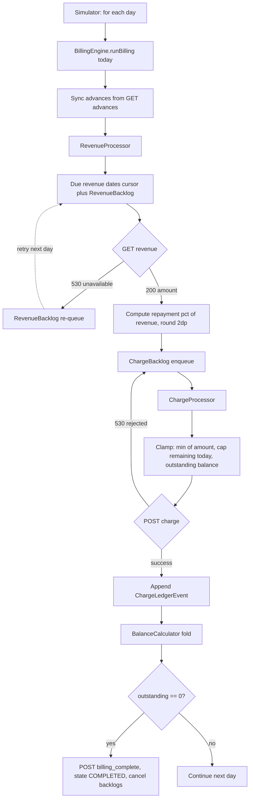
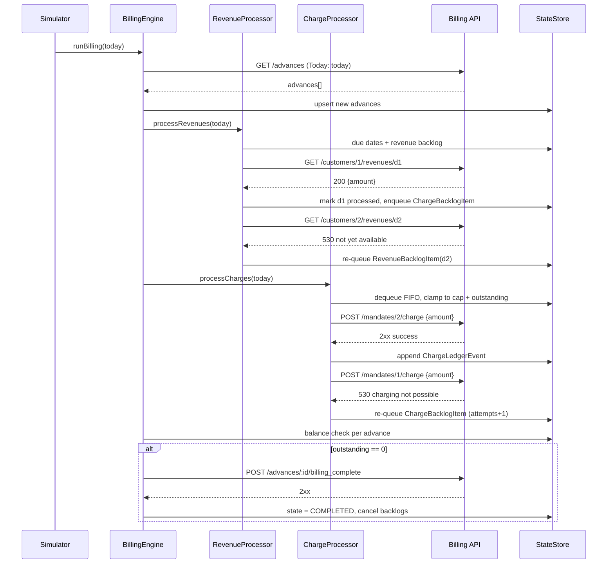
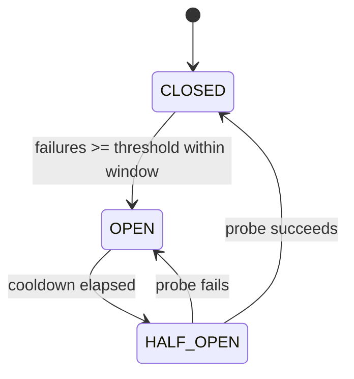

# Wayflyer MCA Billing — Engineering Design Review & Implementation Plan

Language: **TypeScript** (Node 20+, `decimal.js`, `vitest`). In-memory state, CLI-invoked simulation over `2022-01-01 → 2022-02-01`. Designed so persistence/transport can be swapped without touching domain logic.

---

## 1. Requirements Analysis (from [Billing.md](Billing.md))

Explicit requirements, descriptions, and impacts:

- **Daily billing loop** — iterate every date in the simulated period, sending `Today: {date}` header. Impact: a deterministic `Simulator` driving a `BillingEngine.runBilling(today)` entrypoint, exactly as the pseudocode suggests.
- **Discover advances daily** — `GET /advances`; new advances appear over time (verified live: day 1 returns `[]`, advances 1–3 appear by Jan 10). Impact: must re-fetch and upsert advances each day; cannot fetch once.
- **Revenue-percentage repayment** — each day from `repayment_start_date`, charge `repayment_percentage`% of the **previous day's** revenue. Impact: on day `D >= repayment_start_date`, the revenue date owed is `D - 1`; first billable revenue date is `repayment_start_date - 1`.
- **Repay principal + fee** — total obligation = `total_advanced + fee`. Impact: completion check compares settled ledger total against this target; final charge must be clamped to the remaining balance (overcharge prevention).
- **Delayed revenue (530)** — revenue may be unavailable; bill as soon as it becomes available unless already fully repaid. Impact: a **RevenueBacklog** of `(advanceId, revenueDate)` items re-attempted daily.
- **Charge failures (530)** — a charge may be rejected on a given day; reissue on subsequent days. Impact: a **ChargeBacklog** of pending amounts re-attempted daily.
- **Daily charge cap** — total charges per **advance** must not exceed `10000.00` per day; excess split over days. Impact: per-advance per-day charged-amount tracking; split logic feeding the ChargeBacklog. Note: cap is per advance, not per mandate (two advances can share a mandate — verified live).
- **Billing complete** — `POST /advances/:id/billing_complete` after the successful final payment, exactly once. Impact: explicit `AdvanceState` transition `ACTIVE → REPAID → COMPLETED`.
- **Money encoding** — strings with two decimals, single global currency. Impact: `Decimal`-based `Money` utility; never IEEE-754 floats; serialize with `toFixed(2)`.
- **API behaviors** — REST, JSON, `Content-Type: application/json` on POST, 530 as a domain-level "not yet" signal distinct from transport errors.

## 2. Hidden Requirements & Edge Cases

- **Double-billing prevention** — risk: re-fetching `/advances` daily or re-running a day could bill the same revenue date twice. Mitigation: per-advance set of processed revenue dates; a revenue date enters the pipeline exactly once.
- **Revenue replay prevention** — risk: a backlogged revenue date succeeding later, then being picked up again by the daily scheduler. Mitigation: scheduling is driven by a `nextRevenueDateToFetch` cursor + backlog set; an item is moved, never duplicated.
- **Charge retry safety** — risk: retrying a charge that actually succeeded (ambiguous timeout) double-charges a customer. Mitigation: 530 is a *definitive* rejection (safe to retry); ambiguous transport failures are NOT blindly retried for POSTs — they go to a **DeadLetterItem** for reconciliation (assignment says environment is 100% reliable, so this is a design seam, exercised in tests only).
- **Overcharge prevention** — risk: cap-split remainders + late revenue could push settled total past `total_advanced + fee`. Mitigation: every charge amount is `min(desired, capRemainingToday, outstandingBalance)`; outstanding balance computed from the ledger on every charge.
- **Concurrent advances per customer/mandate** — risk: conflating cap or balance across advances sharing a mandate. Mitigation: all accounting keyed by `advanceId`; `mandateId` is only routing for the charge call.
- **Zero/sub-cent amounts** — risk: charging "0.00" or rounding drift. Mitigation: round repayment `revenue × pct / 100` half-up to 2dp once at computation time; skip zero charges but still mark the revenue date processed.
- **Backlog growth / starvation** — risk: a persistently failing mandate grows the backlog unboundedly. Mitigation: FIFO draining per advance, metrics on backlog depth, circuit breaker to stop hammering a failing dependency.
- **Completion with non-empty backlogs** — once the ledger reaches the target, pending revenue fetches and queued charges for that advance are cancelled ("unless the advance has otherwise been fully repaid").
- **End-of-simulation residue** — backlogs may be non-empty on `2022-02-01`; the reporter surfaces unsettled balances rather than silently dropping them.
- **Duplicate `billing_complete`** — guarded by the `REPAID → COMPLETED` state transition; only fires once, retried if the call itself fails.
- **Unexpected API failures (5xx/timeout/network)** — mitigated by RetryPolicy (safe for GET), circuit breaker, and DLQ for ambiguous POSTs.

## 3. Domain Model (`src/domain/`)

- **`Advance`** — fields: `id`, `customerId`, `mandateId`, `created`, `totalAdvanced: Money`, `fee: Money`, `repaymentStartDate`, `repaymentPercentage`, `state: AdvanceState`, `nextRevenueDateToFetch`. Purpose: aggregate root for one financing agreement. Invariants: `totalRepayable = totalAdvanced + fee` is immutable; `nextRevenueDateToFetch` only moves forward; state transitions only `ACTIVE → REPAID → COMPLETED`.
- **`AdvanceState`** — enum `ACTIVE | REPAID | COMPLETED`. Purpose: makes the completion lifecycle explicit; `REPAID` (ledger settled, completion call pending) is distinct from `COMPLETED` (API acknowledged) so a failed `billing_complete` call can be retried without re-charging.
- **`RevenueBacklogItem`** — fields: `advanceId`, `customerId`, `revenueDate`, `firstAttempt`, `attempts`. Purpose: a revenue date we owe billing for but couldn't fetch yet (530). Invariant: unique per `(advanceId, revenueDate)`.
- **`ChargeBacklogItem`** — fields: `id`, `advanceId`, `mandateId`, `amount: Money`, `sourceRevenueDate`, `createdOn`, `attempts`. Purpose: money owed but not yet successfully charged (cap split or 530 rejection). Invariant: `amount > 0`; FIFO order per advance preserved; sum(backlog) + sum(ledger) never exceeds obligation derived from processed revenues.
- **`ChargeLedgerEvent`** — fields: `eventId`, `advanceId`, `mandateId`, `amount: Money`, `chargedOn` (simulated date), `sourceRevenueDate`, `status: SETTLED`. Purpose: append-only record of every successful charge; the *only* source of truth for amount repaid. Invariant: immutable once appended.
- **`DeadLetterItem`** — fields: `id`, `operation`, `payload`, `error`, `occurredOn`, `attempts`. Purpose: terminal parking for operations that exhausted retries or are unsafe to retry (ambiguous POST outcomes); preserves auditability instead of crashing or silently dropping.

## 4. Architectural Decisions

- **Ledger-based accounting over `amountPaid += x`** — auditability: every cent traces to an event with date + source revenue; rebuildability: `amountPaid` is a fold over events, so a bug fix re-derives correct balances; debugging: "why was advance 3 overcharged?" is answerable from data; production migration: the ledger maps 1:1 onto an append-only DB table / Kafka topic, whereas a mutable counter cannot be made consistent retroactively.
- **Explicit backlog queues over `pendingAmount += x`** — preserves *why* money is pending (which revenue date, which failure), enables FIFO fairness, per-item retry counts, ageing metrics, partial draining under the daily cap, and cancellation on completion. A single accumulator loses provenance and makes idempotent replay impossible.
- **`decimal.js` over `number`** — IEEE-754 cannot represent `0.1`; `16500.00 * 0.11`-style arithmetic accumulates drift that, over a 31-day simulation, produces off-by-a-cent balances that break the completion check. Decimal gives exact base-10 arithmetic with explicit rounding (`ROUND_HALF_UP`) and exact `toFixed(2)` serialization. Wrapped in a tiny `Money` module so the library is swappable.
- **Ports & adapters** — services depend on a `BillingApiClient` interface and a `StateStore` interface; resilience (`RetryableBillingApiClient`) is a decorator, not woven into business logic (SRP/OCP/DIP).

## 5. Folder Structure & Responsibilities

```text
src/
  api/
    BillingApiClient.ts          # Port: getAdvances(today), getRevenue(customerId, date, today),
                                 # charge(mandateId, amount, today), billingComplete(advanceId, today).
                                 # + HttpBillingApiClient impl; maps 530 to typed domain results, not exceptions.
    RetryableBillingApiClient.ts # Decorator adding RetryPolicy + CircuitBreaker around transport errors only
                                 # (530 is a business outcome and is NOT retried in-call).
  domain/
    Advance.ts                   # Aggregate + totalRepayable + state transition guards.
    AdvanceState.ts              # ACTIVE | REPAID | COMPLETED enum.
    RevenueBacklogItem.ts        # Pending revenue-date fetches.
    ChargeBacklogItem.ts         # Pending charge amounts (cap splits, 530 rejections).
    ChargeLedgerEvent.ts         # Immutable successful-charge events.
    DeadLetterItem.ts            # Terminal failures for reconciliation.
  services/
    RevenueProcessor.ts          # Per advance: due revenue dates + backlog → fetch revenue →
                                 # compute repayment (pct, rounding) → enqueue ChargeBacklogItem.
    ChargeProcessor.ts           # Drains charge backlog FIFO per advance under daily cap and
                                 # outstanding-balance clamp; appends ledger events; re-queues on 530.
    BalanceCalculator.ts         # Pure: ledger fold → amountRepaid / outstanding / isSettled.
    BillingEngine.ts             # Orchestrates one day: sync advances → revenues → charges →
                                 # completion check → billing_complete.
  store/
    StateStore.ts                # Interface + InMemoryStateStore: advances, backlogs, ledger,
                                 # processed-revenue-date sets, daily charge totals, DLQ.
  infrastructure/
    RetryPolicy.ts               # Exponential backoff + full jitter, configurable, injectable sleep/RNG.
    CircuitBreaker.ts            # CLOSED/OPEN/HALF_OPEN per dependency.
    Logger.ts                    # Structured JSON logger (level, event, advanceId, today, ...).
    Metrics.ts                   # In-memory counters/gauges, dumped in the final report.
  utils/
    Money.ts                     # Decimal wrapper: parse/format("0.00")/add/sub/min/percentOf/compare.
    Idempotency.ts               # Deterministic keys, e.g. charge:{advanceId}:{revenueDate}:{seq}.
  simulation/
    Simulator.ts                 # for today of START..END: engine.runBilling(today).
    SimulationReporter.ts        # End-of-run summary: per-advance repaid/outstanding/state,
                                 # residual backlogs, DLQ, metrics.
  main.ts                        # Composition root: wire config → client → store → engine → simulator.
tests/
  RevenueProcessor.spec.ts
  ChargeProcessor.spec.ts
  BillingEngine.spec.ts
  RetryPolicy.spec.ts
  CircuitBreaker.spec.ts
```

## 6. Flow Diagram



## 7. Sequence Diagram



## 8. Failure Handling Strategy

- **Revenue 530** — detection: status code on GET; behavior: *not* retried in-call (it's "data not ready"), item goes to RevenueBacklog for the next day; logged at INFO with `revenue_unavailable`; metric `revenue_backlog_added`; recovery: automatic on a later day.
- **Charge 530** — detection: status code on POST; behavior: definitive rejection → re-queue full amount in ChargeBacklog for subsequent days; logged WARN `charge_rejected`; metric `charge_failure{reason=530}`; recovery: automatic re-issue.
- **Revenue timeout / 500 / 503 / network / DNS / connection reset (GET)** — detection: fetch error or 5xx; behavior: GET is idempotent → RetryPolicy (exp backoff + full jitter); after max retries, treat as unavailable-today and backlog the date; logs ERROR with attempt count; metrics `api_error{endpoint,code}`, `retry_attempt`; recovery: next-day re-attempt.
- **Charge timeout / connection reset (POST, ambiguous)** — detection: no definitive response; risk: the charge may have landed; behavior: do NOT blind-retry; record `DeadLetterItem` for reconciliation and log ERROR `charge_ambiguous`; metric `dlq_added`. (Assignment promises a reliable environment, so this path exists as a tested design seam, not a hot path.)
- **Charge 500/503 (definitive server error, not processed)** — retry with backoff; on exhaustion, re-queue to ChargeBacklog for tomorrow.
- **Sustained failures** — circuit breaker opens per dependency, short-circuiting calls; remaining work stays queued in backlogs (which are date-driven, so nothing is lost); metric `circuit_opened`.

## 9. Retry Strategy — `RetryPolicy`

- Formula: `delay_n = random_uniform(0, min(maxDelay, baseDelay * 2^n))` — exponential backoff with **full jitter**.
- Config: `maxRetries` (default 3), `baseDelayMs` (100), `maxDelayMs` (2000), injectable `sleep` and `random` for deterministic tests; predicate `isRetryable(error)` so 530 and 4xx are never retried.
- Why full jitter: with many clients (or many queued items) retrying after a shared failure, fixed/equal-jitter backoff synchronizes retries into thundering herds; full jitter spreads load uniformly across the window, giving the best tail-latency/contention trade-off (per the AWS architecture blog analysis).

## 10. Circuit Breaker



- **CLOSED**: calls pass; consecutive-failure counter increments on transport errors (530 does NOT count — it's a business outcome).
- **OPEN**: calls fail fast with `CircuitOpenError`; work remains safely queued in backlogs. Failure threshold default 5; cooldown default 30s wall-clock (configurable; in simulation, injectable clock).
- **HALF_OPEN**: one probe call allowed; success closes, failure re-opens. One breaker instance per endpoint family (revenues, charges).

## 11. Idempotency Strategy

- **Revenue processing** — key `(advanceId, revenueDate)` in a processed-set; checked before fetch/compute; a date is either unprocessed, backlogged, or processed — never two of these. Example: advance 1, date `2022-01-04` fetched on Jan 5; re-running Jan 5 or re-syncing the advance cannot enqueue it again.
- **Charge creation** — ChargeBacklogItems are created only at revenue-processing time (guarded above) or by splitting/re-queueing an existing item — amounts move, they're never minted twice.
- **Charge execution** — each item carries an idempotency key `charge:{advanceId}:{sourceRevenueDate}:{seq}` (sent as a header, ready for a production API that honors it); locally, an item is removed from the queue before the call and only re-queued on a definitive rejection, so a success can't be re-executed.
- **Billing completion** — fired only on the `REPAID → COMPLETED` transition; `COMPLETED` is checked first, so duplicate runs no-op. If the call fails, state stays `REPAID` and is retried next day without any further charging (charging is gated on `outstanding > 0`).

## 12. Daily Charge Limit — Worked Example & Algorithm

Revenue 150,000.00 at 11% → expected repayment **16,500.00**, cap 10,000.00/advance/day:

- Day 1: charged today = 0 → headroom 10,000 → charge **10,000.00**; remainder **6,500.00** re-queued as a ChargeBacklogItem.
- Day 2: headroom 10,000 → charge **6,500.00**; backlog empty.

Algorithm (per advance, per day):

1. `headroom = 10000.00 − chargedToday(advanceId, today)` (from the store's daily totals derived from the ledger).
2. Pop backlog items FIFO. For each: `toCharge = min(item.amount, headroom, outstandingBalance)`.
3. If `toCharge == 0` (no headroom or settled): stop (or cancel items if settled).
4. POST charge. On success: append ledger event, reduce headroom; if `item.amount > toCharge`, re-queue remainder `item.amount − toCharge` (preserving source revenue date). On 530: re-queue whole item for tomorrow and stop draining this advance for today.

## 13. Testing Strategy (vitest, fake `BillingApiClient` + injectable clock)

- Happy path: `bills repayment_percentage of previous day revenue from repayment_start_date until repaid`
- Delayed revenue: `backlogs revenue date on 530 and bills it the day it becomes available`; `does not bill backlogged revenue once advance is settled`
- Charge failure: `re-queues full amount on charge 530 and succeeds on a later day`; `preserves FIFO order across failed days`
- Overcharge prevention: `clamps final charge to outstanding balance`; `never lets ledger total exceed totalAdvanced plus fee`
- Daily cap: `splits 16500 into 10000 then 6500 across two days`; `cap applies per advance not per mandate`; `cap counts all charges for the advance on that day`
- Billing complete: `calls billing_complete exactly once after final settling charge`; `retries billing_complete next day if the call fails, without recharging`
- Duplicate billing: `re-processing same day is a no-op for processed revenue dates`; `advance re-sync does not reset cursor or ledger`
- Retry logic: `retries transient GET failures with full-jitter backoff and gives up after maxRetries`; `never retries 530`
- Circuit breaker: `opens after threshold, fails fast, half-opens after cooldown, closes on probe success`
- Dead letter: `ambiguous POST outcome lands in DLQ and is not retried automatically`
- Money: `rounds 9184.60 at 17 percent half-up to 1561.38`; `serializes with exactly two decimals`
- Integration: `full simulation against scripted fake API ends with all advances COMPLETED and zero residue`

## 14. Observability

- **Structured logging** — one JSON line per event: `{ts, level, event, today, advanceId?, customerId?, mandateId?, amount?, attempt?, detail?}`; the simulated `today` is on every line so a day's activity is greppable.
- **Metrics (counters/gauges)** — `advances_discovered`, `revenue_fetched`, `revenue_unavailable`, `revenue_backlog_added`, `revenue_backlog_processed`, `revenue_backlog_depth`, `charge_attempted`, `charge_success`, `charge_failure`, `charge_amount_total`, `charge_backlog_added`, `charge_backlog_depth`, `charge_cap_splits`, `billing_complete`, `retry_attempt`, `circuit_opened`, `circuit_closed`, `dlq_added`, `api_latency_ms`.
- **Audit trail** — the ChargeLedgerEvent stream *is* the audit log: every settled cent has date, advance, mandate, and source revenue date; the SimulationReporter prints per-advance reconciliation (advanced + fee vs. ledger sum) at the end.

## 15. Production Migration Plan

Business logic (services, domain) is untouched; only adapters swap:

- `InMemoryStateStore` (advances, cursors, processed sets) → **PostgreSQL** tables with unique constraints enforcing idempotency (`UNIQUE(advance_id, revenue_date)`), ledger as an append-only table, balances as a SQL view; daily run wrapped in transactions.
- Backlog queues → **Kafka** topics (`revenue.pending`, `charges.pending`) with consumer groups; DLQ → dead-letter topics; ledger events optionally published for downstream consumers (finance, analytics).
- Daily charge totals / idempotency keys / circuit-breaker state → **Redis** (atomic `INCRBYFLOAT`-style cap accounting with TTL per day, `SETNX` idempotency keys, shared breaker state across instances).
- `Simulator` → a scheduler (cron/Temporal) triggering the same `BillingEngine.runBilling(today)`; `Metrics`/`Logger` → Prometheus + structured log shipping.
- The interfaces `StateStore` and `BillingApiClient` are the seams: production implementations are new classes behind the same ports.

## 16. Implementation Roadmap

- **Phase 1 — Domain & Money**: `utils/Money.ts`, all of `domain/`, `BalanceCalculator`. Deliverable: pure, fully unit-tested value objects and ledger fold. Acceptance: money rounding/serialization tests green; state-transition guards enforced.
- **Phase 2 — Infrastructure**: `RetryPolicy`, `CircuitBreaker`, `Logger`, `Metrics`, `Idempotency`. Deliverable: deterministic (injected clock/RNG) resilience primitives. Acceptance: RetryPolicy + CircuitBreaker specs green.
- **Phase 3 — API & Store**: `BillingApiClient` port + HTTP impl + `RetryableBillingApiClient` decorator; `InMemoryStateStore`. Acceptance: 530 mapped to typed results; live `curl`-equivalent smoke calls work.
- **Phase 4 — Processors**: `RevenueProcessor`, `ChargeProcessor`. Acceptance: backlog, cap-split, clamp, and idempotency specs green.
- **Phase 5 — Engine & Simulation**: `BillingEngine`, `Simulator`, `SimulationReporter`, `main.ts`. Acceptance: full run against the live API completes; report reconciles every advance; engine spec green.
- **Phase 6 — Hardening & Docs**: integration test with scripted fake API, README (setup, run, design summary, production-migration notes), TODO annotations for consciously-deferred work.

## Open Risks / Staff-Review Challenges

- **First billable revenue date**: interpreted as `repayment_start_date − 1` ("every day we charge the previous day's sales", starting on `repayment_start_date`). The fake-API integration test pins this; if reconciliation against the live API shows residue, the alternative (revenue from `created`) is a one-line change in `RevenueProcessor`.
- **Cap scope**: spec says per *advance*; live data shows shared mandates, so per-mandate capping would be wrong — tested explicitly.
- **530 on charge consumes cap?** No — a rejected charge transfers no money, so it must not consume headroom; only ledger events count toward the cap.
- **Post-period residue**: simulation stops at `2022-02-01` per spec; the reporter flags any unsettled advances rather than billing past the window.
